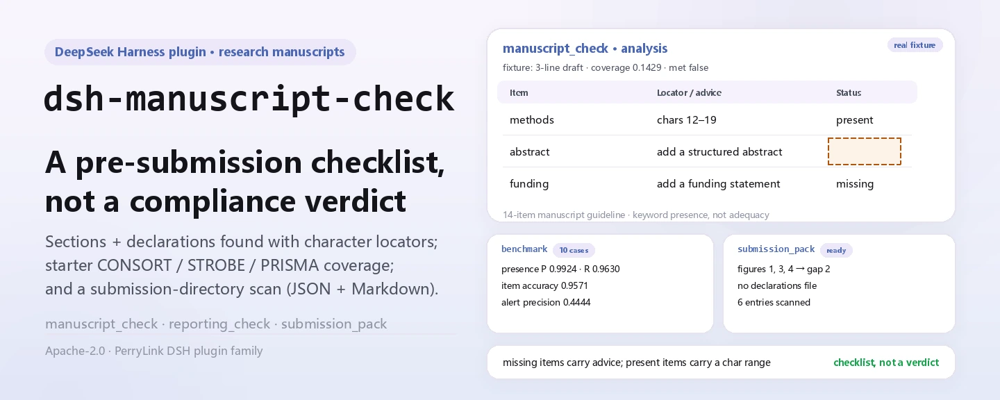
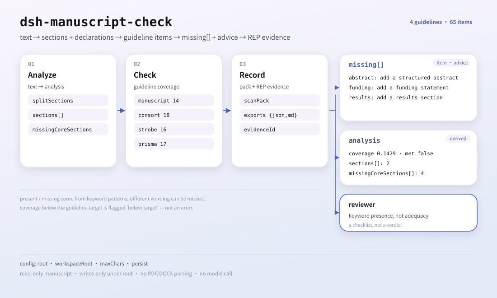
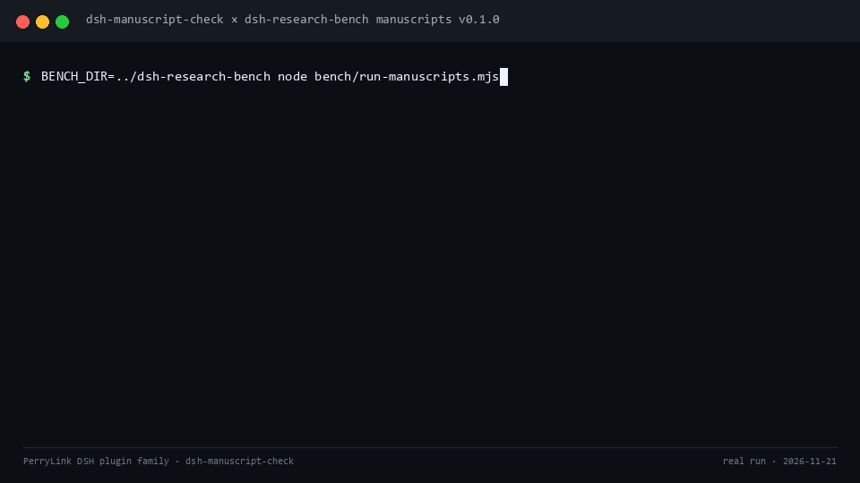

<div align="center">

<picture>
  <source media="(prefers-color-scheme: dark)" srcset="docs/assets/dsh-manuscript-check-hero-en-dark.webp">
  
</picture>

# dsh-manuscript-check

**Una lista de comprobación previa al envío — no un veredicto de cumplimiento.**

*Secciones y declaraciones con localizadores de caracteres, cobertura de ítems de las listas iniciales CONSORT / STROBE / PRISMA (14–18 ítems) y un escaneo del directorio de envío con informes JSON + Markdown.*

[English](README.md) · [简体中文](README-zh.md) · [Español](README-es.md) · [Português](README-pt.md) · [हिन्दी](README-hi.md)

[](LICENSE)
[]()

</div>

---

## Qué hace

- **`manuscript_check`** — detecta título/resumen/introducción/métodos/resultados/discusión/conclusión, las declaraciones habituales (ética, consentimiento, financiación, conflictos, disponibilidad de datos, contribuciones, registro) y comprueba una guía (`manuscript` por defecto, `consort`, `strobe`, `prisma` o `auto` según la redacción). Los ítems ausentes vienen con consejos; los presentes llevan el rango de caracteres que coincidió.
- **`reporting_check`** — varias guías a la vez, una lista plana de ítems ausentes lista para pegar en una lista de comprobación de envío.
- **`submission_pack`** — escanea un directorio de envío en busca de manuscrito, carta de presentación, figuras numeradas (detecta huecos en la numeración), tablas, suplementos y declaraciones; escribe un informe del paquete en JSON + Markdown.

<picture>
  <source media="(prefers-color-scheme: dark)" srcset="docs/assets/dsh-manuscript-check-flow-v5-dark.svg">
  
</picture>

*Estructura: analizar → comprobar → registrar; `missing[]` y `analysis` son las dos salidas, el escaneo del paquete escribe JSON + Markdown bajo `root`, y una coincidencia de palabra clave es presencia, no suficiencia. Las etiquetas de token dentro del diagrama son los nombres reales de funciones, herramientas y campos, así que la misma imagen sirve para los cinco idiomas.*

## Qué no hace

- **Ningún veredicto de cumplimiento.** La presencia se detecta por patrones de palabras clave. Una declaración redactada con otras palabras puede pasarse por alto, y una palabra clave presente no significa que el contenido sea suficiente. El README, las descripciones de las herramientas y todos los informes lo dicen.
- **Sin análisis de PDF/DOCX.** Convierte a `.md`/`.txt`/`.tex`, o extrae el texto del PDF con `dsh-doc-anchor`.
- **Sin reproducción completa de las guías.** Son listas iniciales (14–18 ítems), no las listas certificadas CONSORT/STROBE/PRISMA.
- **Sin subidas, sin conversión, sin renombrado.** El escaneo del paquete informa; nunca mueve un archivo.
- **Sin reglas propias de cada revista** (límites de palabras, estilos de referencia): eso pertenece a un perfil de revista, no a este plugin.

## Objetivos de cobertura

| Guía | Ítems | Objetivo |
|---|---:|---:|
| `manuscript` (estructura + declaraciones) | 14 | 80% |
| `consort` (inicial) | 18 | 75% |
| `strobe` (inicial) | 16 | 75% |
| `prisma` (inicial) | 17 | 75% |

Una cobertura por debajo del objetivo se marca como "below target"; no es un error.

## Herramientas

### `manuscript_check`

`{ text? | path?, guideline?, persist? }` → `{ ok, analysis, evidenceId?, recordPath? }`.
`analysis = { sections, missingCoreSections, wordCount, results[], notes }`.

### `reporting_check`

`{ text? | path?, guidelines?: string[] }` → `{ ok, analysis, missing[], evidenceId? }`.

### `submission_pack`

`{ path?, recursive? }` → `{ ok, pack, exports: {json, markdown} }`.

### Códigos de error

`INVALID_INPUT` · `NOT_FOUND` · `PATH_ESCAPE` · `NOT_A_FILE` · `NOT_A_DIRECTORY` · `TOO_LARGE` · `UNSUPPORTED_FILE` · `STORE_ERROR`

## Compatibilidad e instalación

| | |
|---|---|
| DeepSeek Harness | **`dsh-v0.2.3-alpha.1`** (verificado 2026-11-22); peer `>=0.2.1-0 <0.3.0 \|\| >=0.2.2-0 <0.3.0` |
| Node | `^22.19.0 \|\| >=24.9.0` (probado en `24.22.1`), solo ESM |
| Peers | `@perrylink/dsh-research-core ^0.1.0`, `@deepseek-ai/cordis ^4.0.5-alpha.1`, `@deepseek-ai/dsh-tools`, `@deepseek-ai/schemastery ^3.18.5-alpha.1` |
| Dependencias en tiempo de ejecución | **cero** |

```sh
dsh plugin --profile <name> add @perrylink/dsh-research-core dsh-manuscript-check
dsh --profile <name> --dump-config | grep dsh-manuscript-check
```

## Configuración

| Clave | Valor por defecto | Significado |
|---|---|---|
| `enabled` | `true` | `false` no monta nada |
| `root` | `.manuscript-check` | raíz de almacén, registros y exportaciones |
| `workspaceRoot` | `process.cwd()` | las rutas del manuscrito deben resolverse dentro de ella |
| `maxChars` | `2000000` | tope duro (falla; nunca trunca) |
| `persist` | `true` | guarda el texto comprobado como evidencia REP + registro |

## Límites de seguridad

- Solo lectura sobre el manuscrito; las únicas escrituras van bajo `root`.
- Contención de rutas con `realpath` (se rechazan las fugas por enlaces simbólicos).
- El tope de caracteres falla de forma explícita en lugar de truncar; un archivo recibe un tope de bytes
  antes de leerse, así que un archivo demasiado grande no puede agotar la memoria.
- PDF/DOCX se rechazan con un mensaje claro en lugar de analizarse de forma insegura.

## Evaluación



*Animado: el stdout real de `pnpm run bench:manuscripts` sobre el dataset congelado de `dsh-research-bench` (sin red, salida determinista; reejecutado el 2026-11-21). Las dos últimas líneas son dos de las seis omisiones medidas — cuatro están en el manuscrito STROBE de contenido completo — y se reportan, no se ocultan.*

**22 pruebas**: división en secciones (markdown + texto plano + markdown con título y secciones en texto plano), cobertura de guías (fixture completo estilo CONSORT ≥90%, ítems ausentes con consejos, localizadores), detección automática, catálogo de guías, escaneo de paquetes (paquete completo, hueco de figura, declaraciones ausentes, no listo sin manuscrito), runtime (validez del registro REP, guía automática + lectura de archivos, rechazo de travesía/binario/tamaño excesivo incluido un tope de bytes previo a la lectura, exportaciones del paquete), herramientas (esquemas, lista plana de ausentes, rama de fallo), contrato del paquete.

### Benchmark de manuscritos sintéticos

Un benchmark determinista aparte (dataset `manuscripts` v0.1.0, congelado) vive en el repositorio hermano `dsh-research-bench` bajo `data/manuscripts`; no está vendorizado en este paquete. Diez manuscritos sintéticos de 300–800 palabras (525–774 palabras cada uno; 6.361 en total) llevan **140 etiquetas de ítem** de la guía `manuscript` de 14 ítems (135 presentes / 5 ausentes), más una etiqueta de documento para `missingCoreSections`.

Cobertura: ensayo clínico completo estilo CONSORT, ética/consentimiento ausentes, disponibilidad de datos ausente, aleatorización/registro ausentes, resumen ausente, métodos estadísticos ausentes, cohorte estilo STROBE, revisión estilo PRISMA, un título en texto plano sin markdown `#`, y un título mixto chino-inglés.

El adaptador llama a `analyzeManuscript(text, [guidelineOf('manuscript')], ['manuscript'])` una vez por manuscrito y escribe [`bench/results-manuscripts.json`](bench/results-manuscripts.json) y [`bench/results-manuscripts.md`](bench/results-manuscripts.md) (sin marcas de tiempo; reejecutar es idéntico byte a byte).

```sh
pnpm run bench:manuscripts   # builds, then reads ../dsh-research-bench/data/manuscripts (BENCH_DIR overrides)
```

| Métrica | TP | FP | FN | TN | Precisión | Exhaustividad | F1 |
|---|---:|---:|---:|---:|---:|---:|---:|
| Presencia de ítems (positivo = `present`, principal) | 130 | 1 | 5 | 4 | 0.9924 | 0.9630 | 0.9774 |
| Alerta de ítem ausente (positivo = `missing`) | 4 | 5 | 1 | 130 | 0.4444 | 0.8000 | 0.5714 |

- Exactitud por ítem **0.9571** (134/140); la exactitud por documento va de 0.7143 a 1.0000.
- Coincidencia exacta de `missingCoreSections` a nivel de documento **10/10** (1.0000).
- Los 14 ítems son exactos en 7/10 documentos.

**Omisiones medidas (las etiquetas no se cambiaron).** Cuatro de las cinco omisiones de presencia están en el manuscrito STROBE de contenido completo: `funding` ("supported by"), `conflicts` ("competing financial interests"), `data` ("dataset is deposited") y `contributions` (una línea de roles sin "Author contributions" ni pista CRediT). La quinta es el título en texto plano: la pista de título exige `#` o `Title:`, así que una línea de título suelta se omite. El único falso presente es `abstract` en el manuscrito sin resumen, donde "In summary" en la discusión coincide con `summary`. Como las alertas de ausencia son lo que el usuario usa, la fila de alertas importa: cuatro ítems presentes omitidos más el título en texto plano se convierten en cinco falsas alarmas, así que la precisión de alertas es 0.4444 aunque la cobertura de presencia sea alta.

**Límite del espacio de etiquetas.** La guía `manuscript` de 14 ítems no tiene ítem de métodos estadísticos ni de aleatorización. `ms-0004` (sin aleatorización/registro) y `ms-0006` (sin métodos estadísticos) ejercitan esos huecos de contenido, pero solo se puntúa el registro ausente de `ms-0004`; `ms-0006` es de 14 presentes por construcción. No cites este benchmark como evidencia de que esos dos huecos se detectan.

**Advertencia de validez.** Los diez manuscritos sintéticos y las reglas de palabras clave fueron escritos por el mismo proyecto. Esto es una **línea base de regresión, no una estimación insesgada** de la exactitud sobre manuscritos reales. Las etiquetas las fija el generador; ninguna se cambió después de ver el detector.

## Limitaciones conocidas (v0.1)

- Detección por palabras clave: otra redacción → falso "missing"; palabra clave presente → no es una comprobación de suficiencia.
- Solo pistas en inglés; los manuscritos en chino necesitan sus propias listas de pistas.
- Sin requisitos propios de cada revista (recuento de palabras, estilo de referencias, ORCID, metadatos del sistema de envío).
- El escaneo del paquete está limitado en profundidad y se basa en nombres de archivo; las tablas incrustadas no se detectan.

## Licencia

Apache-2.0. Sin código de terceros en tiempo de ejecución.
