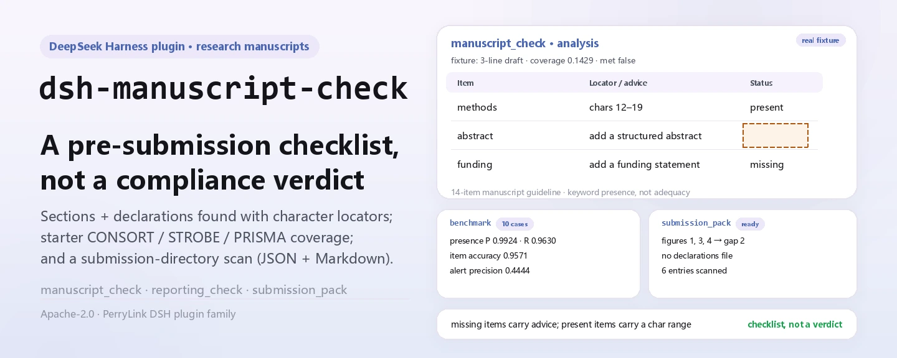
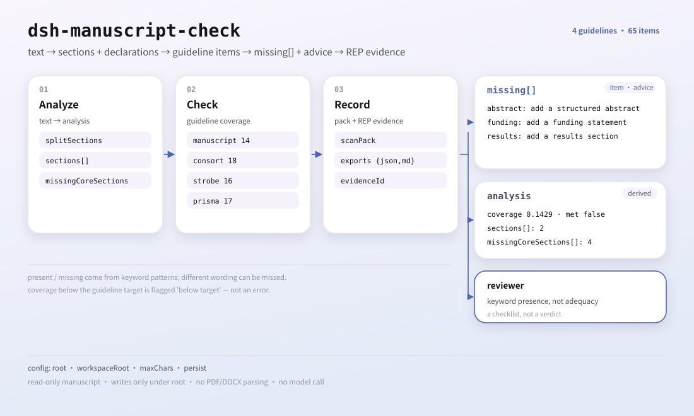
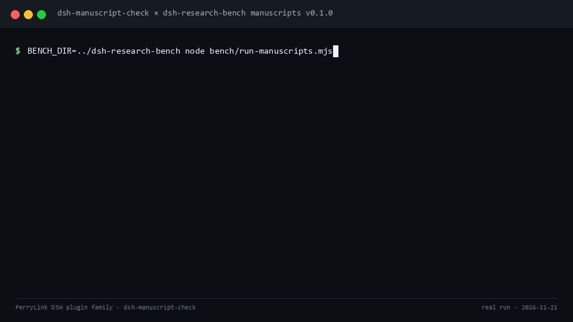

<div align="center">

<picture>
  <source media="(prefers-color-scheme: dark)" srcset="docs/assets/dsh-manuscript-check-hero-en-dark.webp">
  
</picture>

# dsh-manuscript-check

**सबमिशन से पहले की जाँच-सूची — अनुपालन का निर्णय नहीं।**

*कैरेक्टर लोकेटर के साथ अनुभाग और घोषणाएँ, शुरुआती CONSORT / STROBE / PRISMA आइटम कवरेज (14–18 आइटम), और JSON + Markdown रिपोर्ट के साथ सबमिशन-निर्देशिका स्कैन।*

[English](README.md) · [简体中文](README-zh.md) · [Español](README-es.md) · [Português](README-pt.md) · [हिन्दी](README-hi.md)

[](LICENSE)
[]()

</div>

---

## यह क्या करता है

- **`manuscript_check`** — शीर्षक/सार/परिचय/विधियाँ/परिणाम/चर्चा/निष्कर्ष और सामान्य घोषणाएँ (नैतिकता, सहमति, फ़ंडिंग, हितों का टकराव, डेटा उपलब्धता, योगदान, पंजीकरण) खोजता है, और एक दिशानिर्देश जाँचता है (`manuscript` डिफ़ॉल्ट, `consort`, `strobe`, `prisma`, या शब्दावली से `auto`)। अनुपस्थित आइटम सुझाव के साथ आते हैं; मौजूद आइटम वह कैरेक्टर-रेंज लेकर आते हैं जो मेल खाता है।
- **`reporting_check`** — एक साथ कई दिशानिर्देश, अनुपस्थित आइटमों की सपाट सूची जिसे सीधे सबमिशन चेकलिस्ट में चिपकाया जा सकता है।
- **`submission_pack`** — सबमिशन निर्देशिका में मैन्युस्क्रिप्ट, कवर लेटर, क्रमांकित चित्र (क्रमांकन में अंतराल पकड़ता है), तालिकाएँ, परिशिष्ट और घोषणाएँ खोजता है; JSON + Markdown पैक रिपोर्ट लिखता है।


<picture>
  <source media="(prefers-color-scheme: dark)" srcset="docs/assets/dsh-manuscript-check-flow-v5-dark.svg">
  
</picture>

*संरचना: विश्लेषण → जाँच → रिकॉर्ड; `missing[]` और `analysis` दो आउटपुट हैं, पैक स्कैन `root` के अंतर्गत JSON + Markdown लिखता है, और कीवर्ड का मिलना उपस्थिति है, पर्याप्तता नहीं। डायग्राम के अंदर टोकन लेबल असली फ़ंक्शन, टूल और फ़ील्ड नाम हैं, इसलिए एक ही चित्र पाँचों भाषाओं के लिए काम आता है।*

## यह क्या नहीं करता

- **कोई अनुपालन निर्णय नहीं।** उपस्थिति कीवर्ड पैटर्न से पकड़ी जाती है। अलग शब्दों में लिखी गई घोषणा छूट सकती है, और कीवर्ड का मिलना यह नहीं दर्शाता कि सामग्री पर्याप्त है। README, टूल विवरण और हर रिपोर्ट यही कहते हैं।
- **PDF/DOCX पार्सिंग नहीं।** `.md`/`.txt`/`.tex` में बदलें, या `dsh-doc-anchor` से PDF टेक्स्ट निकालें।
- **दिशानिर्देशों की पूरी प्रतिकृति नहीं।** ये शुरुआती सूचियाँ (14–18 आइटम) हैं, प्रमाणित CONSORT/STROBE/PRISMA सूचियाँ नहीं।
- **कोई अपलोड, रूपांतरण या नाम-परिवर्तन नहीं।** पैक स्कैन रिपोर्ट करता है; कभी फ़ाइल नहीं हिलाता।
- **किसी पत्रिका-विशिष्ट नियम नहीं** (शब्द-सीमा, संदर्भ शैली): वे एक जर्नल प्रोफ़ाइल के अधीन हैं, इस प्लगइन के नहीं।

## कवरेज लक्ष्य

| दिशानिर्देश | आइटम | लक्ष्य |
|---|---:|---:|
| `manuscript` (संरचना + घोषणाएँ) | 14 | 80% |
| `consort` (शुरुआती) | 18 | 75% |
| `strobe` (शुरुआती) | 16 | 75% |
| `prisma` (शुरुआती) | 17 | 75% |

लक्ष्य से नीचे की कवरेज "below target" के रूप में चिह्नित होती है; यह त्रुटि नहीं है।

## टूल

### `manuscript_check`

`{ text? | path?, guideline?, persist? }` → `{ ok, analysis, evidenceId?, recordPath? }`.
`analysis = { sections, missingCoreSections, wordCount, results[], notes }`.

### `reporting_check`

`{ text? | path?, guidelines?: string[] }` → `{ ok, analysis, missing[], evidenceId? }`.

### `submission_pack`

`{ path?, recursive? }` → `{ ok, pack, exports: {json, markdown} }`.

### त्रुटि कोड

`INVALID_INPUT` · `NOT_FOUND` · `PATH_ESCAPE` · `NOT_A_FILE` · `NOT_A_DIRECTORY` · `TOO_LARGE` · `UNSUPPORTED_FILE` · `STORE_ERROR`

## संगतता और इंस्टॉल

| | |
|---|---|
| DeepSeek Harness | **`dsh-v0.2.2-rc.4`** (2026-11-18 को सत्यापित); peer `>=0.2.1-0 <0.3.0 \|\| >=0.2.2-0 <0.3.0` |
| Node | `^22.19.0 \|\| >=24.9.0` (`24.22.1` पर परीक्षित), केवल ESM |
| Peers | `@perrylink/dsh-research-core ^0.1.0`, `@deepseek-ai/cordis ^4.0.5-alpha.1`, `@deepseek-ai/dsh-tools`, `@deepseek-ai/schemastery ^3.18.5-alpha.1` |
| रनटाइम निर्भरताएँ | **शून्य** |

```sh
dsh plugin --profile <name> add @perrylink/dsh-research-core dsh-manuscript-check
dsh --profile <name> --dump-config | grep dsh-manuscript-check
```

## कॉन्फ़िगरेशन

| कुंजी | डिफ़ॉल्ट | अर्थ |
|---|---|---|
| `enabled` | `true` | `false` कुछ भी माउंट नहीं करता |
| `root` | `.manuscript-check` | स्टोर, रिकॉर्ड और एक्सपोर्ट का रूट |
| `workspaceRoot` | `process.cwd()` | मैन्युस्क्रिप्ट के पथ इसी के अंदर रिज़ॉल्व होने चाहिए |
| `maxChars` | `2000000` | कठोर सीमा (विफल होती है; कभी काटती नहीं) |
| `persist` | `true` | जाँचे गए टेक्स्ट को REP एविडेंस + रिकॉर्ड के रूप में संग्रहीत करता है |

## सुरक्षा सीमाएँ

- मैन्युस्क्रिप्ट पर केवल-पढ़ने की पहुँच; एकमात्र लेखन `root` के अंतर्गत होता है।
- `realpath` के साथ पथ-नियंत्रण (सिमलिंक से बाहर निकलना अस्वीकृत)।
- कैरेक्टर सीमा काटने के बजाय स्पष्ट रूप से विफल होती है; फ़ाइल पढ़े जाने से पहले उस पर बाइट-सीमा
  लगती है, इसलिए बहुत बड़ी फ़ाइल मेमोरी नहीं खा सकती।
- PDF/DOCX असुरक्षित तरीके से पार्स होने के बजाय स्पष्ट संदेश के साथ अस्वीकृत होते हैं।

## मूल्यांकन



*एनिमेटेड: फ़्रोज़न `dsh-research-bench` manuscripts डेटासेट पर `pnpm run bench:manuscripts` का असली stdout (कोई नेटवर्क नहीं, डिटरमिनिस्टिक आउटपुट; 2026-11-21 को फिर से चलाया गया)। अंतिम दो पंक्तियाँ छह मापी गई चूकों में से दो हैं — इनमें से चार सामग्री-पूर्ण STROBE मैन्युस्क्रिप्ट में हैं — और उन्हें छिपाया नहीं, रिपोर्ट किया जाता है।*


**22 टेस्ट**: अनुभाग विभाजन (markdown + सादा टेक्स्ट + markdown शीर्षक/सादा अनुभाग मिश्रित), दिशानिर्देश कवरेज (पूर्ण CONSORT-शैली fixture ≥90%, सुझाव के साथ अनुपस्थित आइटम, लोकेटर), स्वतः पहचान, दिशानिर्देश सूची, पैक स्कैनिंग (पूर्ण पैक, चित्र अंतराल, अनुपस्थित घोषणाएँ, मैन्युस्क्रिप्ट के बिना तैयार नहीं), रनटाइम (REP रिकॉर्ड वैधता, auto दिशानिर्देश + फ़ाइल पढ़ना, traversal/बाइनरी/अति-आकार अस्वीकृति जिसमें पढ़ने से पहले बाइट सीमा शामिल है, पैक एक्सपोर्ट), टूल (स्कीमा, सपाट अनुपस्थित सूची, विफलता शाखा), पैकेज अनुबंध।

### सिंथेटिक मैन्युस्क्रिप्ट बेंचमार्क

एक अलग डिटरमिनिस्टिक बेंचमार्क (डेटासेट `manuscripts` v0.1.0, फ़्रोज़न) सहोदर रिपॉज़िटरी `dsh-research-bench` में `data/manuscripts` के अंतर्गत रहता है; यह इस पैकेज में vendor नहीं किया गया है। दस सिंथेटिक मैन्युस्क्रिप्ट, प्रत्येक 300–800 शब्द (525–774 शब्द; कुल 6,361), 14-आइटम `manuscript` दिशानिर्देश के **140 आइटम लेबल** रखते हैं (135 मौजूद / 5 अनुपस्थित), साथ में दस्तावेज़-स्तरीय `missingCoreSections` लेबल।

कवरेज: पूर्ण CONSORT-शैली परीक्षण, नैतिकता/सहमति अनुपस्थित, डेटा उपलब्धता अनुपस्थित, रैंडमाइज़ेशन/पंजीकरण अनुपस्थित, सार अनुपस्थित, सांख्यिकीय विधियाँ अनुपस्थित, STROBE-शैली कोहोर्ट, PRISMA-शैली समीक्षा, markdown `#` के बिना सादा-टेक्स्ट शीर्षक, और चीनी-अंग्रेज़ी मिश्रित शीर्षक।

अडैप्टर प्रति मैन्युस्क्रिप्ट एक बार `analyzeManuscript(text, [guidelineOf('manuscript')], ['manuscript'])` कॉल करता है और [`bench/results-manuscripts.json`](bench/results-manuscripts.json) तथा [`bench/results-manuscripts.md`](bench/results-manuscripts.md) लिखता है (कोई टाइमस्टैम्प नहीं; दोबारा चलाना बाइट-दर-बाइट समान है)।

```sh
pnpm run bench:manuscripts   # builds, then reads ../dsh-research-bench/data/manuscripts (BENCH_DIR overrides)
```

| मीट्रिक | TP | FP | FN | TN | Precision | Recall | F1 |
|---|---:|---:|---:|---:|---:|---:|---:|
| आइटम उपस्थिति (धनात्मक = `present`, मुख्य) | 130 | 1 | 5 | 4 | 0.9924 | 0.9630 | 0.9774 |
| अनुपस्थित-आइटम अलर्ट (धनात्मक = `missing`) | 4 | 5 | 1 | 130 | 0.4444 | 0.8000 | 0.5714 |

- आइटम सटीकता **0.9571** (134/140); प्रति-दस्तावेज़ सटीकता 0.7143 से 1.0000 तक है।
- दस्तावेज़-स्तरीय `missingCoreSections` सटीक मिलान **10/10** (1.0000)।
- सभी 14 आइटम 7/10 दस्तावेज़ों पर सटीक हैं।

**मापी गई चूकें (लेबल नहीं बदले गए)।** पाँच उपस्थिति-चूकों में से चार सामग्री-पूर्ण STROBE मैन्युस्क्रिप्ट में हैं: `funding` ("supported by"), `conflicts` ("competing financial interests"), `data` ("dataset is deposited") और `contributions` (भूमिकाओं की पंक्ति जिसमें "Author contributions" या CRediT संकेत नहीं है)। पाँचवीं सादा-टेक्स्ट शीर्षक है: शीर्षक संकेत के लिए `#` या `Title:` आवश्यक है, इसलिए अकेली सादी शीर्षक पंक्ति छूट जाती है। एकमात्र गलत-मौजूद `abstract` है उस मैन्युस्क्रिप्ट में जिसमें सार नहीं है, जहाँ चर्चा में "In summary" `summary` से मेल खाता है। चूँकि उपयोगकर्ता अनुपस्थिति अलर्ट पर कार्रवाई करता है, अलर्ट पंक्ति मायने रखती है: चार छूटे मौजूद आइटम और सादा शीर्षक मिलकर पाँच गलत अलार्म बनते हैं, इसलिए उपस्थिति कवरेज ऊँची होने पर भी अलर्ट precision 0.4444 है।

**लेबल-स्पेस की सीमा।** 14-आइटम `manuscript` दिशानिर्देश में सांख्यिकीय-विधियाँ या रैंडमाइज़ेशन का कोई आइटम नहीं है। `ms-0004` (रैंडमाइज़ेशन/पंजीकरण नहीं) और `ms-0006` (सांख्यिकीय विधियाँ नहीं) उन सामग्री-अंतरालों को अभ्यास में लाते हैं, पर केवल `ms-0004` का अनुपस्थित पंजीकरण स्कोर होता है; `ms-0006` रचना से ही सभी-14-मौजूद है। इस बेंचमार्क को इस बात के प्रमाण के रूप में न उद्धृत करें कि वे दो अंतराल पकड़े जाते हैं।

**वैधता की चेतावनी।** दस सिंथेटिक मैन्युस्क्रिप्ट और कीवर्ड नियम एक ही परियोजना ने लिखे हैं। यह असली मैन्युस्क्रिप्ट पर सटीकता का **रिग्रेशन बेसलाइन है, निष्पक्ष अनुमान नहीं**। लेबल जनरेटर द्वारा तय होते हैं; डिटेक्टर देखने के बाद कोई भी नहीं बदला गया।

## ज्ञात सीमाएँ (v0.1)

- कीवर्ड पहचान: अलग शब्दावली → गलत "missing"; कीवर्ड मौजूद → यह पर्याप्तता की जाँच नहीं है।
- केवल अंग्रेज़ी संकेत; चीनी मैन्युस्क्रिप्ट के लिए अपनी संकेत-सूचियाँ चाहिए।
- पत्रिका-विशिष्ट आवश्यकताएँ नहीं (शब्द-गणना, संदर्भ शैली, ORCID, सबमिशन-सिस्टम मेटाडेटा)।
- पैक स्कैन गहराई-सीमित और फ़ाइल-नाम आधारित है; अंतःस्थापित तालिकाएँ नहीं पकड़ी जातीं।

## लाइसेंस

Apache-2.0. रनटाइम पर कोई तृतीय-पक्ष कोड नहीं।
