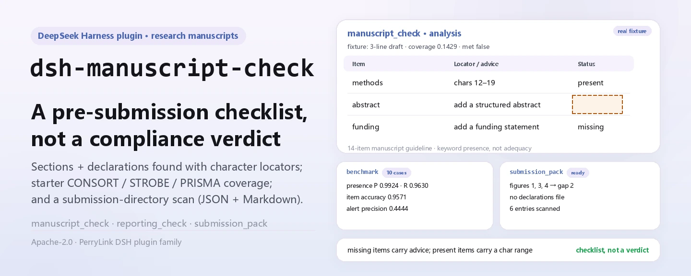
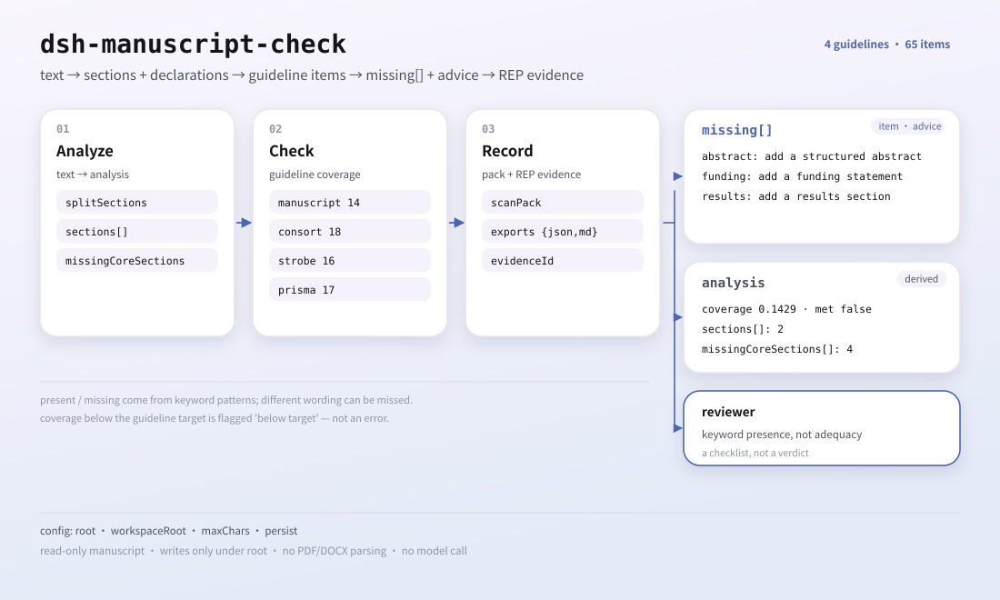
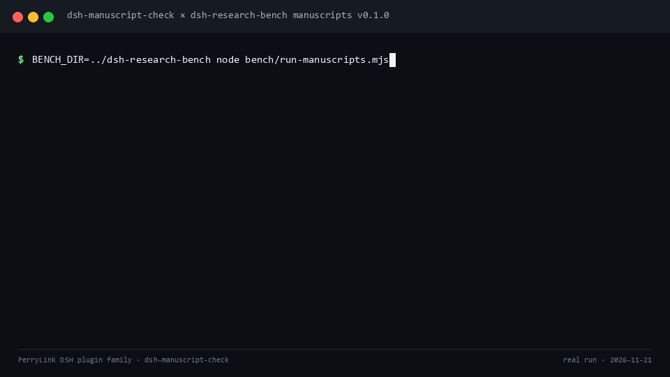

<div align="center">

<picture>
  <source media="(prefers-color-scheme: dark)" srcset="docs/assets/dsh-manuscript-check-hero-en-dark.webp">
  
</picture>

# dsh-manuscript-check

**Uma lista de verificação antes da submissão — não um veredicto de conformidade.**

*Seções e declarações com localizadores de caracteres, cobertura de itens das listas iniciais CONSORT / STROBE / PRISMA (14–18 itens) e uma varredura do diretório de submissão com relatórios JSON + Markdown.*

[English](README.md) · [简体中文](README-zh.md) · [Español](README-es.md) · [Português](README-pt.md) · [हिन्दी](README-hi.md)

[](LICENSE)
[]()

</div>

---

## O que faz

- **`manuscript_check`** — detecta título/resumo/introdução/métodos/resultados/discussão/conclusão, as declarações usuais (ética, consentimento, financiamento, conflitos, disponibilidade de dados, contribuições, registro) e verifica uma diretriz (`manuscript` por padrão, `consort`, `strobe`, `prisma`, ou `auto` pela redação). Os itens ausentes vêm com orientações; os presentes trazem o intervalo de caracteres que correspondeu.
- **`reporting_check`** — várias diretrizes de uma vez, uma lista plana de itens ausentes pronta para colar em uma lista de verificação de submissão.
- **`submission_pack`** — varre um diretório de submissão em busca de manuscrito, carta de apresentação, figuras numeradas (detecta lacunas na numeração), tabelas, suplementos e declarações; escreve um relatório do pacote em JSON + Markdown.

<picture>
  <source media="(prefers-color-scheme: dark)" srcset="docs/assets/dsh-manuscript-check-flow-v5-dark.svg">
  
</picture>

*Estrutura: analisar → verificar → registrar; `missing[]` e `analysis` são as duas saídas, a varredura do pacote escreve JSON + Markdown sob `root`, e uma correspondência de palavra-chave é presença, não suficiência. Os rótulos de token dentro do diagrama são os nomes reais de funções, ferramentas e campos, então a mesma imagem serve aos cinco idiomas.*

## O que não faz

- **Nenhum veredicto de conformidade.** A presença é detectada por padrões de palavras-chave. Uma declaração escrita com outras palavras pode escapar, e uma palavra-chave presente não significa que o conteúdo seja suficiente. O README, as descrições das ferramentas e todo relatório dizem isso.
- **Sem análise de PDF/DOCX.** Converta para `.md`/`.txt`/`.tex`, ou extraia o texto do PDF com `dsh-doc-anchor`.
- **Sem reprodução completa das diretrizes.** São listas iniciais (14–18 itens), não as listas certificadas CONSORT/STROBE/PRISMA.
- **Sem upload, sem conversão, sem renomeação.** A varredura do pacote informa; nunca move um arquivo.
- **Sem regras específicas de periódico** (limites de palavras, estilos de referência): isso pertence a um perfil de periódico, não a este plugin.

## Metas de cobertura

| Diretriz | Itens | Meta |
|---|---:|---:|
| `manuscript` (estrutura + declarações) | 14 | 80% |
| `consort` (inicial) | 18 | 75% |
| `strobe` (inicial) | 16 | 75% |
| `prisma` (inicial) | 17 | 75% |

Cobertura abaixo da meta é sinalizada como "below target"; não é um erro.

## Ferramentas

### `manuscript_check`

`{ text? | path?, guideline?, persist? }` → `{ ok, analysis, evidenceId?, recordPath? }`.
`analysis = { sections, missingCoreSections, wordCount, results[], notes }`.

### `reporting_check`

`{ text? | path?, guidelines?: string[] }` → `{ ok, analysis, missing[], evidenceId? }`.

### `submission_pack`

`{ path?, recursive? }` → `{ ok, pack, exports: {json, markdown} }`.

### Códigos de erro

`INVALID_INPUT` · `NOT_FOUND` · `PATH_ESCAPE` · `NOT_A_FILE` · `NOT_A_DIRECTORY` · `TOO_LARGE` · `UNSUPPORTED_FILE` · `STORE_ERROR`

## Compatibilidade e instalação

| | |
|---|---|
| DeepSeek Harness | **`dsh-v0.2.3-alpha.1`** (verificado em 2026-11-22); peer `>=0.2.1-0 <0.3.0 \|\| >=0.2.2-0 <0.3.0` |
| Node | `^22.19.0 \|\| >=24.9.0` (testado em `24.22.1`), somente ESM |
| Peers | `@perrylink/dsh-research-core ^0.1.0`, `@deepseek-ai/cordis ^4.0.5-alpha.1`, `@deepseek-ai/dsh-tools`, `@deepseek-ai/schemastery ^3.18.5-alpha.1` |
| Dependências em tempo de execução | **zero** |

```sh
dsh plugin --profile <name> add @perrylink/dsh-research-core dsh-manuscript-check
dsh --profile <name> --dump-config | grep dsh-manuscript-check
```

## Configuração

| Chave | Padrão | Significado |
|---|---|---|
| `enabled` | `true` | `false` não monta nada |
| `root` | `.manuscript-check` | raiz de armazenamento, registros e exportações |
| `workspaceRoot` | `process.cwd()` | os caminhos do manuscrito devem resolver dentro dela |
| `maxChars` | `2000000` | limite rígido (falha; nunca trunca) |
| `persist` | `true` | armazena o texto verificado como evidência REP + registro |

## Limites de segurança

- Somente leitura sobre o manuscrito; as únicas escritas ficam sob `root`.
- Contenção de caminhos com `realpath` (fugas por links simbólicos são rejeitadas).
- O limite de caracteres falha ruidosamente em vez de truncar; um arquivo recebe um limite de bytes
  antes de ser lido, então um arquivo grande demais não pode esgotar a memória.
- PDF/DOCX são rejeitados com uma mensagem clara em vez de serem analisados de forma insegura.

## Avaliação



*Animado: o stdout real de `pnpm run bench:manuscripts` sobre o dataset congelado do `dsh-research-bench` (sem rede, saída determinística; reexecutado em 2026-11-21). As duas últimas linhas são duas das seis omissões medidas — quatro estão no manuscrito STROBE de conteúdo completo — e são reportadas, não escondidas.*

**22 testes**: divisão em seções (markdown + texto puro + markdown com título e seções em texto puro), cobertura de diretrizes (fixture completo estilo CONSORT ≥90%, itens ausentes com orientações, localizadores), detecção automática, catálogo de diretrizes, varredura de pacotes (pacote completo, lacuna de figura, declarações ausentes, não pronto sem manuscrito), runtime (validade do registro REP, diretriz automática + leitura de arquivos, rejeição de travessia/binário/tamanho excessivo incluindo um limite de bytes antes da leitura, exportações do pacote), ferramentas (esquemas, lista plana de ausentes, ramo de falha), contrato do pacote.

### Benchmark de manuscritos sintéticos

Um benchmark determinístico separado (dataset `manuscripts` v0.1.0, congelado) vive no repositório irmão `dsh-research-bench` em `data/manuscripts`; ele não é vendorizado neste pacote. Dez manuscritos sintéticos de 300–800 palavras (525–774 palavras cada; 6.361 no total) carregam **140 rótulos de item** da diretriz `manuscript` de 14 itens (135 presentes / 5 ausentes), mais um rótulo de documento para `missingCoreSections`.

Cobertura: ensaio clínico completo estilo CONSORT, ética/consentimento ausentes, disponibilidade de dados ausente, randomização/registro ausentes, resumo ausente, métodos estatísticos ausentes, coorte estilo STROBE, revisão estilo PRISMA, um título em texto puro sem markdown `#`, e um título misto chinês-inglês.

O adaptador chama `analyzeManuscript(text, [guidelineOf('manuscript')], ['manuscript'])` uma vez por manuscrito e escreve [`bench/results-manuscripts.json`](bench/results-manuscripts.json) e [`bench/results-manuscripts.md`](bench/results-manuscripts.md) (sem carimbos de tempo; reexecutar é idêntico byte a byte).

```sh
pnpm run bench:manuscripts   # builds, then reads ../dsh-research-bench/data/manuscripts (BENCH_DIR overrides)
```

| Métrica | TP | FP | FN | TN | Precisão | Revocação | F1 |
|---|---:|---:|---:|---:|---:|---:|---:|
| Presença de itens (positivo = `present`, principal) | 130 | 1 | 5 | 4 | 0.9924 | 0.9630 | 0.9774 |
| Alerta de item ausente (positivo = `missing`) | 4 | 5 | 1 | 130 | 0.4444 | 0.8000 | 0.5714 |

- Exatidão por item **0.9571** (134/140); a exatidão por documento varia de 0.7143 a 1.0000.
- Correspondência exata de `missingCoreSections` no nível do documento **10/10** (1.0000).
- Os 14 itens são exatos em 7/10 documentos.

**Omissões medidas (os rótulos não foram alterados).** Quatro das cinco omissões de presença estão no manuscrito STROBE de conteúdo completo: `funding` ("supported by"), `conflicts` ("competing financial interests"), `data` ("dataset is deposited") e `contributions` (uma linha de papéis sem "Author contributions" ou pista CRediT). A quinta é o título em texto puro: a pista de título exige `#` ou `Title:`, então uma linha de título isolada é omitida. O único falso presente é `abstract` no manuscrito sem resumo, onde "In summary" na discussão corresponde a `summary`. Como os alertas de ausência são o que o usuário usa, a linha de alertas importa: quatro itens presentes omitidos mais o título em texto puro viram cinco falsos alarmes, então a precisão dos alertas é 0.4444 mesmo com cobertura de presença alta.

**Limite do espaço de rótulos.** A diretriz `manuscript` de 14 itens não tem item de métodos estatísticos nem de randomização. `ms-0004` (sem randomização/registro) e `ms-0006` (sem métodos estatísticos) exercitam essas lacunas de conteúdo, mas só o registro ausente de `ms-0004` é pontuado; `ms-0006` tem os 14 presentes por construção. Não cite este benchmark como evidência de que essas duas lacunas são detectadas.

**Ressalva de validade.** Os dez manuscritos sintéticos e as regras de palavras-chave foram escritos pelo mesmo projeto. Isto é uma **linha de base de regressão, não uma estimativa não enviesada** da exatidão em manuscritos reais. Os rótulos são fixados pelo gerador; nenhum foi alterado depois de ver o detector.

## Limitações conhecidas (v0.1)

- Detecção por palavras-chave: outra redação → falso "missing"; palavra-chave presente → não é uma verificação de suficiência.
- Apenas pistas em inglês; manuscritos em chinês precisam de suas próprias listas de pistas.
- Sem requisitos específicos de periódico (contagem de palavras, estilo de referências, ORCID, metadados do sistema de submissão).
- A varredura do pacote é limitada em profundidade e baseada em nomes de arquivo; tabelas embutidas não são detectadas.

## Licença

Apache-2.0. Sem código de terceiros em tempo de execução.
