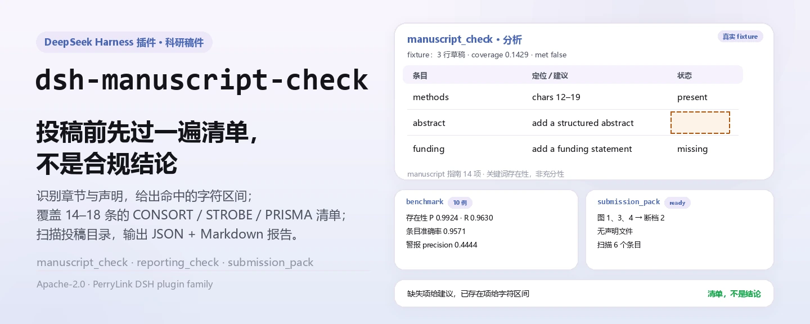
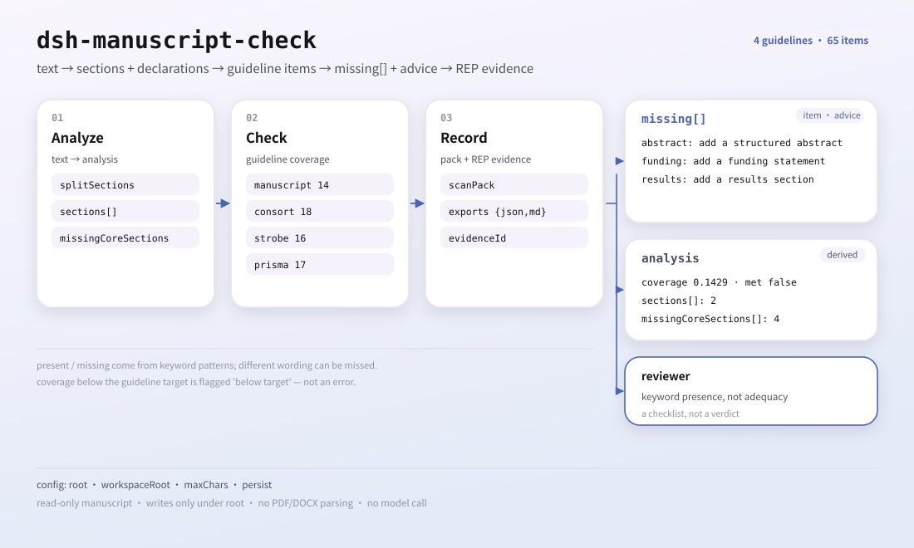
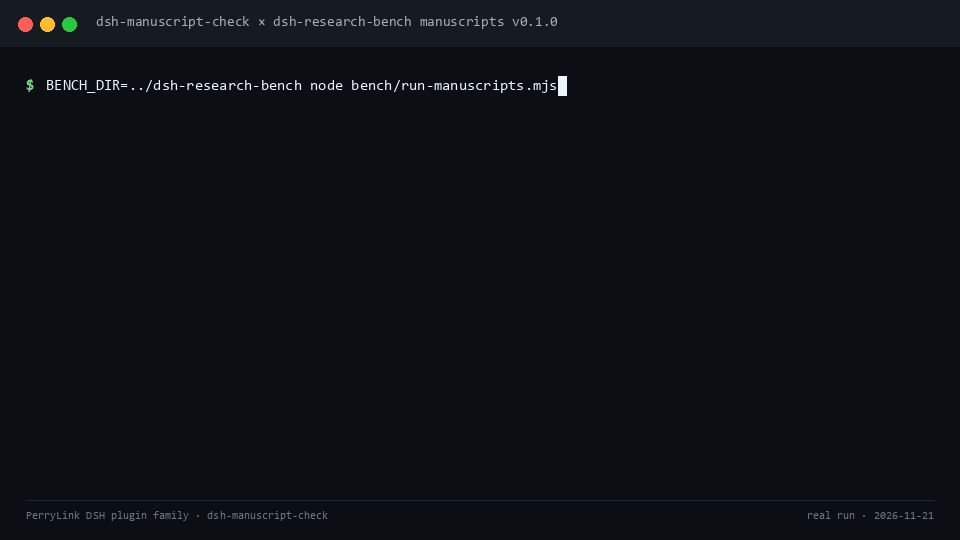

<div align="center">

<picture>
  <source media="(prefers-color-scheme: dark)" srcset="docs/assets/dsh-manuscript-check-hero-zh-dark.webp">
  
</picture>

# dsh-manuscript-check

**投稿前的检查清单 —— 不是合规结论。**

*识别章节与声明并给出字符区间；起步版 CONSORT / STROBE / PRISMA 条目覆盖（14–18 项）；扫描投稿目录并输出 JSON + Markdown 报告。*

[English](README.md) · [Español](README-es.md) · [Português](README-pt.md) · [हिन्दी](README-hi.md)

[](LICENSE)
[]()

</div>

---

## 它做什么

- **`manuscript_check`** —— 识别标题/摘要/引言/方法/结果/讨论/结论，以及常见声明（伦理、知情同意、资助、利益冲突、数据可用性、贡献、注册），并检查一套指南（默认 `manuscript`，也可为 `consort`、`strobe`、`prisma`，或由措辞自动判断的 `auto`）。缺失项附带建议；已存在的项会给出命中的字符区间。
- **`reporting_check`** —— 一次检查多套指南，输出一份扁平化缺失项列表，可直接粘贴到投稿检查清单。
- **`submission_pack`** —— 扫描投稿目录中的稿件、cover letter、编号图（能发现编号断档）、表格、补充材料与声明；写出 JSON + Markdown 材料包报告。


<picture>
  <source media="(prefers-color-scheme: dark)" srcset="docs/assets/dsh-manuscript-check-flow-v5-dark.svg">
  
</picture>

*结构：分析 → 检查 → 记录；`missing[]` 与 `analysis` 是两条输出，投稿包扫描把 JSON + Markdown 写进 `root`，关键词命中只代表“存在”而不代表“充分”。图内只有真实的函数名、工具名与字段名，五语共用同一张结构图。*

## 它不做什么

- **不做合规判定。** 是否存在由关键词模式判断。换个说法写的声明可能被漏掉，而关键词出现也不等于内容充分。README、工具描述和每一份报告都会说明这一点。
- **不解析 PDF/DOCX。** 请先转换为 `.md`/`.txt`/`.tex`，或用 `dsh-doc-anchor` 抽取 PDF 文本。
- **不完整复刻指南。** 这些是起步清单（14–18 项），不是经认证的 CONSORT/STROBE/PRISMA 清单。
- **不上传、不转换、不改名。** 材料包扫描只报告，绝不移动文件。
- **不包含期刊特定规则**（字数限制、参考文献格式）：这些属于期刊 profile，不属于本插件。

## 覆盖目标

| 指南 | 条目数 | 目标 |
|---|---:|---:|
| `manuscript`（结构 + 声明） | 14 | 80% |
| `consort`（起步版） | 18 | 75% |
| `strobe`（起步版） | 16 | 75% |
| `prisma`（起步版） | 17 | 75% |

覆盖率低于目标时会标为“below target”；这不是错误。

## 工具

### `manuscript_check`

`{ text? | path?, guideline?, persist? }` → `{ ok, analysis, evidenceId?, recordPath? }`。
`analysis = { sections, missingCoreSections, wordCount, results[], notes }`。

### `reporting_check`

`{ text? | path?, guidelines?: string[] }` → `{ ok, analysis, missing[], evidenceId? }`。

### `submission_pack`

`{ path?, recursive? }` → `{ ok, pack, exports: {json, markdown} }`。

### 错误码

`INVALID_INPUT` · `NOT_FOUND` · `PATH_ESCAPE` · `NOT_A_FILE` · `NOT_A_DIRECTORY` · `TOO_LARGE` · `UNSUPPORTED_FILE` · `STORE_ERROR`

## 兼容性与安装

| | |
|---|---|
| DeepSeek Harness | **`dsh-v0.2.2-rc.4`**（2026-11-18 实测）；peer `>=0.2.1-0 <0.3.0 \|\| >=0.2.2-0 <0.3.0` |
| Node | `^22.19.0 \|\| >=24.9.0`（实测 `24.22.1`），仅 ESM |
| Peer 依赖 | `@perrylink/dsh-research-core ^0.1.0`、`@deepseek-ai/cordis ^4.0.5-alpha.1`、`@deepseek-ai/dsh-tools`、`@deepseek-ai/schemastery ^3.18.5-alpha.1` |
| 运行时依赖 | **零** |

```sh
dsh plugin --profile <name> add @perrylink/dsh-research-core dsh-manuscript-check
dsh --profile <name> --dump-config | grep dsh-manuscript-check
```

## 配置

| 键 | 默认值 | 含义 |
|---|---|---|
| `enabled` | `true` | `false` 时不挂载任何内容 |
| `root` | `.manuscript-check` | 存储、记录与导出的根目录 |
| `workspaceRoot` | `process.cwd()` | 稿件路径必须解析到该目录内 |
| `maxChars` | `2000000` | 硬上限（超限即失败；绝不截断） |
| `persist` | `true` | 将被检查的文本存为 REP 证据并写入记录 |

## 安全边界

- 对稿件只读；唯一的写入发生在 `root` 下。
- 用 `realpath` 做路径包含校验（拒绝符号链接逃逸）。
- 字符数上限会显式失败，而不是截断；文件在读取前先按字节上限校验，因此超大文件无法耗尽内存。
- PDF/DOCX 会以明确提示拒绝，而不是不安全地解析。

## 评测



*动图是 `node bench/run-manuscripts.mjs` 在冻结的 `dsh-research-bench` manuscripts 数据集上的真实 stdout（`BENCH_DIR` 指向同级 checkout；不联网、输出确定；2026-11-21 复跑）。末尾两行是 6 条实测误判中的两条 —— 其中四条出现在内容完整的 STROBE 稿件里，如实报告而不是隐藏。*


**22 个测试**：章节切分（markdown + 纯文本 + markdown 标题/纯文本章节混排）、指南覆盖（完整的 CONSORT 风格 fixture ≥90%、缺失项带建议、定位信息）、自动识别、指南目录、材料包扫描（完整材料包、图表编号断档、声明缺失、没有稿件时判定未就绪）、运行时（REP 记录合法性、auto 指南 + 文件读取、路径遍历/二进制/超大文件拒绝（含读取前字节上限）、材料包导出）、tools（schema、扁平缺失列表、失败分支）、包契约。

### 合成稿件基准

一份独立的确定性基准（数据集 `manuscripts` v0.1.0，已冻结）位于同级仓库 `dsh-research-bench` 的 `data/manuscripts`，不随本包发布。10 篇 300–800 词的合成稿件（每篇 525–774 词，共 6,361 词）带有 **140 个条目标签**（14 项 `manuscript` 指南；135 个 present / 5 个 missing）以及文档级 `missingCoreSections` 标签。

覆盖：完整 CONSORT 风格试验、缺伦理/同意、缺数据可用性、缺随机化/注册、缺摘要、缺统计方法、STROBE 风格队列、PRISMA 风格综述、无 markdown `#` 的纯文本标题，以及中英混排标题。

适配器逐篇调用 `analyzeManuscript(text, [guidelineOf('manuscript')], ['manuscript'])`，写出 [`bench/results-manuscripts.json`](bench/results-manuscripts.json) 与 [`bench/results-manuscripts.md`](bench/results-manuscripts.md)（不含时间戳；重跑逐字节一致）。

```sh
pnpm run bench:manuscripts   # 先构建，再读取 ../dsh-research-bench/data/manuscripts（BENCH_DIR 可覆盖）
```

| 指标 | TP | FP | FN | TN | 精确率 | 召回率 | F1 |
|---|---:|---:|---:|---:|---:|---:|---:|
| 条目存在（正类 = `present`，主指标） | 130 | 1 | 5 | 4 | 0.9924 | 0.9630 | 0.9774 |
| 缺失告警（正类 = `missing`） | 4 | 5 | 1 | 130 | 0.4444 | 0.8000 | 0.5714 |

- 条目准确率 **0.9571**（134/140）；逐文档准确率在 0.7143–1.0000 之间。
- 文档级 `missingCoreSections` 完全匹配 **10/10**（1.0000）。
- 7/10 篇文档的 14 项全部正确。

**实测漏检/误报（未修改标签）。** 5 个漏检中有 4 个出现在内容完整的 STROBE 稿件里：`funding`（"supported by"）、`conflicts`（"competing financial interests"）、`data`（"dataset is deposited"）、`contributions`（仅列作者分工，没有 "Author contributions" 或 CRediT 线索）。第 5 个是纯文本标题：标题线索只认 `#` 或 `Title:`，独立一行的标题会被漏掉。唯一的 present 误报是缺摘要稿件的 `abstract`：讨论中的 "In summary" 命中了 `summary`。用户真正会据以行动的是“缺失”告警，因此告警行同样重要：4 个漏检的 present 项加上纯文本标题，会变成 5 个缺失告警误报，所以即使存在项覆盖很高，告警精确率仍只有 0.4444。

**标签空间限制。** 14 项 `manuscript` 指南没有“统计方法”或“随机化”条目。`ms-0004`（缺随机化/注册）与 `ms-0006`（缺统计方法）用于覆盖这两类内容缺口，但只有 `ms-0004` 的注册缺失会被计分；`ms-0006` 按构造是 14 项全 present。不要把本基准当作“这两类缺口已被检出”的证据。

**有效性说明。** 10 篇合成稿件与关键词规则由同一项目编写。这是**回归基线，不是无偏的真实稿件准确率估计**。标签由生成器固定，看到检测结果后没有改过任何标签。

## 已知限制（v0.1）

- 关键词检测：措辞不同 → 误报“缺失”；关键词出现 → 也不代表内容充分。
- 只有英文线索词；中文稿件需要自己的线索词表。
- 不含期刊特定要求（字数、参考文献格式、ORCID、投稿系统元数据）。
- 材料包扫描受深度限制，且依据文件名；内嵌表格无法识别。

## 许可

Apache-2.0。运行时不含第三方代码。
